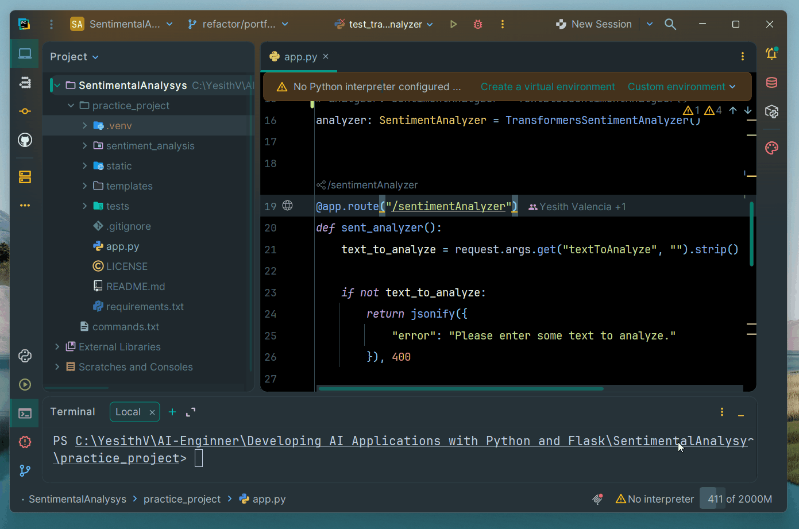
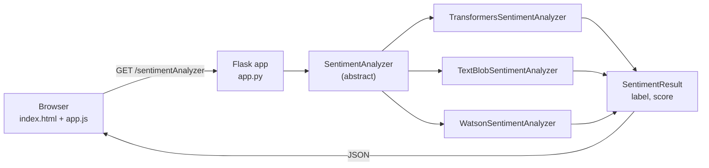

# Sentiment Analysis App

## 1. Overview

A web application built with **Python** and **Flask** that detects the sentiment of a piece of text (positive, negative or neutral) using embedded AI libraries.

The project started as a practice exercise from the *Developing AI Applications with Python and Flask* course, which relied on a hosted IBM Watson NLP service. It was later refactored to run fully locally with interchangeable sentiment engines (Hugging Face Transformers and TextBlob) behind a common interface.

## 2. Features

- Simple web UI to enter text and view the predicted sentiment with its confidence score.
- JSON REST endpoint (`/sentimentAnalyzer`) that other clients can consume.
- Pluggable analyzers through an abstract `SentimentAnalyzer` interface: swap the engine without touching the web layer.
- Three implementations: DistilBERT (default), TextBlob and IBM Watson (legacy).
- Input validation with clear error messages on both the client and the server.
- Unit tests for each local analyzer.

## 3. Demo



## 4. Architecture

The app follows a simple layered design. The Flask layer depends only on the `SentimentAnalyzer` abstraction, and every concrete engine returns the same immutable `SentimentResult` (`label`, `score`).



Request flow:

1. The user types text and clicks **Analyze Sentiment**.
2. `app.js` sends `GET /sentimentAnalyzer?textToAnalyze=...`.
3. `app.py` validates the input and calls `analyzer.analyze(text)`.
4. The selected engine returns a `SentimentResult`, serialized as JSON.
5. The UI shows the label and the score as a percentage.

## 5. Tech Stack

| Layer | Technology |
|---|---|
| Backend | Python, [Flask](https://flask.palletsprojects.com/) |
| NLP / ML | [Hugging Face Transformers](https://huggingface.co/docs/transformers), [PyTorch](https://pytorch.org/), [TextBlob](https://textblob.readthedocs.io/) |
| External API (legacy) | IBM Watson NLP via `requests` |
| Frontend | HTML, CSS, vanilla JavaScript (Fetch API) |
| Testing | `unittest` |

## 6. Project Structure

```
sentiment-analysis-app/
├── app.py                      # Flask server and routes
├── requirements.txt
├── assets/
│   └── sentimental-analysis.gif
├── sentiment_analysis/
│   ├── analyzer.py             # SentimentAnalyzer abstract base class
│   ├── result.py               # SentimentResult dataclass (label, score)
│   └── implementations/
│       ├── transformers_analyzer.py
│       ├── textblob_analyzer.py
│       └── watson_analyzer.py
├── static/
│   ├── css/styles.css
│   └── js/app.js
├── templates/
│   └── index.html
└── tests/
    ├── test_textblob_analyzer.py
    └── test_transformers_analyzer.py
```

## 7. Sentiment Analysis Approaches

### 7.1 Hugging Face Transformers / DistilBERT

**Default engine.** Uses the `pipeline("sentiment-analysis")` API with the [`distilbert/distilbert-base-uncased-finetuned-sst-2-english`](https://huggingface.co/distilbert/distilbert-base-uncased-finetuned-sst-2-english) model, a smaller, faster version of BERT fine-tuned on the SST-2 movie review dataset.

- Labels: `POSITIVE`, `NEGATIVE`.
- Score: the model's confidence in the predicted label (0–1).
- The model is downloaded on first run and cached locally; after that it works offline.

### 7.2 TextBlob

A lexicon- and rule-based approach. TextBlob computes a **polarity** value in the range `[-1, 1]`, which is mapped to a label:

| Polarity | Label |
|---|---|
| `> 0` | `POSITIVE` |
| `< 0` | `NEGATIVE` |
| `= 0` | `NEUTRAL` |

The returned score is the absolute polarity. It is lightweight, fast and needs no model download, but it is less accurate with context, negation and sarcasm.

### 7.3 IBM Watson (Legacy)

The original implementation from the course. It sends a `POST` request to the IBM Watson NLP `SentimentPredict` endpoint using the `sentiment_aggregated-bert-workflow_lang_multi_stock` model.

> **Note:** this endpoint is only reachable from inside the IBM Skills Network lab environment, so it will not work locally. It is kept for reference and to show how the abstraction supports remote engines.

## 8. Running Locally

**Prerequisites:** Python 3.10+ and `pip`.

```bash
git clone <repository-url>
cd sentiment-analysis-app

python -m venv .venv
# Windows
.venv\Scripts\activate
# Linux / macOS
source .venv/bin/activate

pip install -r requirements.txt
python app.py
```

Open [http://localhost:5000](http://localhost:5000) in your browser.

> The first run downloads the DistilBERT model from Hugging Face, so it may take a few minutes.

To switch engines, change the analyzer instance in [app.py](app.py):

```python
analyzer: SentimentAnalyzer = TextBlobSentimentAnalyzer()
```

To add a new engine, create a class that inherits from `SentimentAnalyzer` and implements `analyze(text: str) -> SentimentResult`.

## 9. Running Tests

```bash
python -m unittest discover tests
```

The Transformers tests load the real model, so the first run requires internet access.

## 10. API

### `GET /sentimentAnalyzer`

| Query parameter | Type | Required | Description |
|---|---|---|---|
| `textToAnalyze` | string | Yes | Text to analyze |

**Success (`200 OK`):**

```json
{
  "label": "POSITIVE",
  "score": 0.99
}
```

**Error (`400 Bad Request`)** when the text is empty:

```json
{
  "error": "Please enter some text to analyze."
}
```

**Example:**

```bash
curl "http://localhost:5000/sentimentAnalyzer?textToAnalyze=I%20love%20Python"
```

## 11. Model Comparison

| | DistilBERT (Transformers) | TextBlob | IBM Watson (Legacy) |
|---|---|---|---|
| Approach | Fine-tuned transformer | Lexicon / rules | Hosted BERT workflow |
| Labels | `POSITIVE`, `NEGATIVE` | `POSITIVE`, `NEGATIVE`, `NEUTRAL` | Service-defined |
| Score meaning | Model confidence | Absolute polarity | Service confidence |
| Context understanding | High | Low | High |
| Speed | Moderate (CPU) | Very fast | Network-dependent |
| Footprint | Large (PyTorch + model) | Small | Small (HTTP client) |
| Runs offline | Yes, after first download | Yes | No |

## 12. What I Learned

- Integrating pre-trained NLP models into a web app with Hugging Face `pipeline`.
- Trade-offs between rule-based and deep learning sentiment analysis.
- Applying the Strategy pattern with abstract base classes to decouple the web layer from the model.
- Using immutable dataclasses as a consistent contract between components.
- Building and validating a small JSON API with Flask.
- Writing unit tests for ML-backed components.

## 13. Future Improvements

- Select the analyzer through an environment variable or config file instead of editing code.
- Switch the endpoint to `POST` with a JSON body to support longer texts.
- Add a `NEUTRAL` class for the Transformers engine (e.g., a 3-class or multilingual model).
- Add Flask route tests and mock the model in unit tests to speed up CI.
- Containerize the app with Docker and deploy it to a cloud service.
- Show the results of all engines side by side in the UI.

## 14. License

Distributed under the Apache License 2.0. See [LICENSE](LICENSE) for details.
